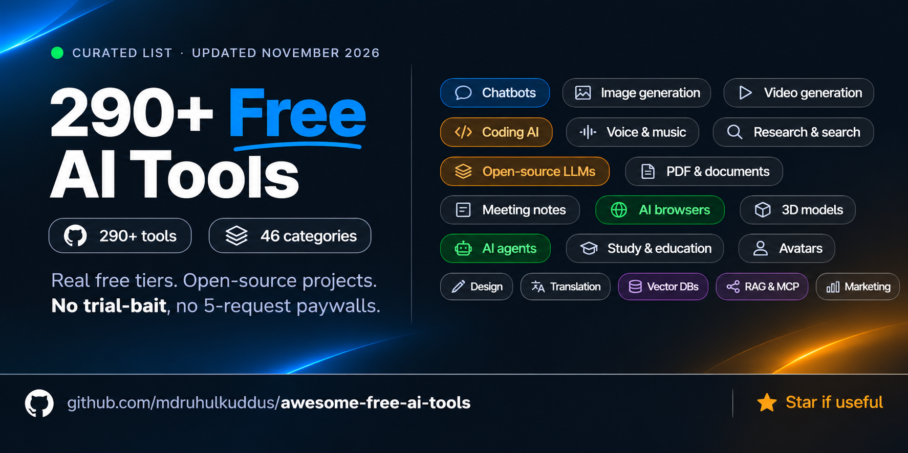

# Awesome Free AI Tools

  
  
  
  
  
  
  

  

  

  

---

## 📖 Introduction

A curated, opinionated list of the best **genuinely free** AI tools available right now — real free tiers, open-source projects, and freemium plans where the free tier is actually usable for real work. No "free means 3 generations then paywall." No trial-bait.

**290+ tools · 46 categories · Last updated: November 6, 2026**

**How to read an entry:** `Free:` = what you actually get · `Best for:` = who should use it · `Catch:` = the honest limitation. Entries marked *(re-check)* could not be confirmed against a current source and may have changed.

> **v1.4 changelog** — Re-verified all five top chatbots and every developer free tier. Removed 12 dead or paywalled tools. Added 10 new categories (AI browsers, OCR, vector DBs, RAG, MCP, observability, workflow automation, computer-use agents, voice/on-device AI, stem separation) and a new [Trending now](#-trending-now) section at the top.

---

## Table of contents

- [🔥 Trending now](#-trending-now)
- [🌟 Top AI chatbots](#-top-ai-chatbots)
  - [The Top 3](#the-top-3)
  - [Strong alternatives](#strong-alternatives)
- [Other chatbots & assistants](#other-chatbots--assistants)
- [AI browsers & browser agents](#ai-browsers--browser-agents) 🆕
- [AI research & search](#ai-research--search)
- [Writing, editing & paraphrasing](#writing-editing--paraphrasing)
- [Document & PDF AI](#document--pdf-ai)
- [OCR & document extraction](#ocr--document-extraction) 🆕
- [Productivity, notes & knowledge management](#productivity-notes--knowledge-management)
- [Meeting notes & transcription](#meeting-notes--transcription)
- [Translation & speech-to-text](#translation--speech-to-text)
- [Presentations & design](#presentations--design)
- [Data & spreadsheets](#data--spreadsheets)
- [Image generation](#image-generation)
- [Image editing & enhancement](#image-editing--enhancement)
- [Video generation](#video-generation)
- [Video editing with AI](#video-editing-with-ai)
- [Audio, music & voice](#audio-music--voice)
- [Audio stem separation](#audio-stem-separation) 🆕
- [Avatars & talking heads](#avatars--talking-heads)
- [3D model generation](#3d-model-generation)
- [AI coding assistants](#ai-coding-assistants)
- [AI app builders (vibe coding)](#ai-app-builders-vibe-coding)
- [Code review AI](#code-review-ai)
- [AI-powered dev tools](#ai-powered-dev-tools)
- [Developer APIs with free tiers](#developer-apis-with-free-tiers)
- [Local & open-source LLM runners](#local--open-source-llm-runners)
- [Notable open-weight models](#notable-open-weight-models)
- [RAG frameworks](#rag-frameworks) 🆕
- [Vector databases & embeddings](#vector-databases--embeddings) 🆕
- [MCP servers & tooling](#mcp-servers--tooling) 🆕
- [AI observability & evals](#ai-observability--evals) 🆕
- [Workflow automation & no-code AI](#workflow-automation--no-code-ai) 🆕
- [AI agents & autonomous workflows](#ai-agents--autonomous-workflows)
- [Computer-use agents](#computer-use-agents) 🆕
- [Voice agents & on-device AI](#voice-agents--on-device-ai) 🆕
- [AI detection & humanizers](#ai-detection--humanizers)
- [Resume & career AI](#resume--career-ai)
- [Study & education AI](#study--education-ai)
- [Math & STEM solvers](#math--stem-solvers)
- [Marketing & SEO AI](#marketing--seo-ai)
- [Website builders with AI](#website-builders-with-ai)
- [AI companions & roleplay](#ai-companions--roleplay)
- [Prompt libraries](#prompt-libraries)
- [Finance AI](#finance-ai)
- [Medical & clinical AI](#medical--clinical-ai)
- [Email AI](#email-ai)
- [⚠️ Removed since April 2026](#️-removed-since-april-2026)
- [🆕 New since April 2026](#-new-since-april-2026)
- [Contributing](#contributing)

---

## 🔥 Trending now

The free tiers that changed most in the last six months, and the tools people are actually switching to. Everything here is also listed in its own category below.

| Tool | Why it's trending | Free tier |
|---|---|---|
| **[ChatGPT](https://chatgpt.com)** | Free text chat went **unlimited** (Aug 6), now on GPT-6 Luna | Unlimited text; tools still capped |
| **[Claude](https://claude.ai)** | Design, Slides and Docs landed on the **free** plan | Sonnet 5.5 + Haiku 5.5 |
| **[Perplexity Comet](https://www.perplexity.ai/comet)** | First fully-agentic AI browser, **free on all platforms** | Free Win/Mac/iOS/Android |
| **[Devin Desktop](https://devin.ai)** | Windsurf rebranded; **unlimited free Tab completions** | Unlimited autocomplete |
| **[Kimi K3](https://huggingface.co/moonshotai)** | Largest open-weight model ever released (2.8T) | Free weights |
| **[DeepSeek V4](https://huggingface.co/deepseek-ai)** | Frontier-class reasoning under **MIT** licence | Free chat + free weights |
| **[Gemini Notebook](https://notebook.google)** | NotebookLM renamed, gained code execution | 100 notebooks × 50 sources |
| **[Google Antigravity](https://antigravity.google)** | Replaced Gemini CLI as the free agentic dev platform | Free public beta |
| **[Marker](https://github.com/datalab-to/marker)** | The default PDF→Markdown tool for RAG pipelines | Open source |
| **[UI-TARS](https://github.com/bytedance/UI-TARS)** | Self-hosted computer-use agent beating commercial CUAs | Apache 2.0 |
| **[Activepieces](https://www.activepieces.com)** | MIT automation with AI agents on **every** tier | Free self-host + cloud |
| **[GLM-5.2](https://huggingface.co/zai-org)** | NIST called it likely the most capable open-weight model | Free weights |

> ⚠️ **Trending the wrong way:** Gemini's free tier was **cut back** on Oct 9 to Flash-Lite with a 32K context. Cerebras killed its free API tier. GitHub Models shut down entirely. See [Removed](#️-removed-since-april-2026).

---

## 🌟 Top AI chatbots

Three all-round leaders, plus two specialists worth a second tab.

### The Top 3

#### Claude (Anthropic)

- **Link:** [claude.ai](https://claude.ai)
- **At a glance:** Free: Sonnet 5.5, Artifacts, Projects, Design/Slides/Docs | Best for: writing, coding, long documents | Catch: rolling 5-hour cap; no Opus or Claude Code
- **Best at:** Long-form writing, careful reasoning, coding, document work. The most natural writer of the three.
- **Free tier:** **Claude Sonnet 5.5 + Haiku 5.5**. Web search, memory across conversations, file creation with code execution, Artifacts, Projects (up to 5), Skills, connectors, and **Claude Design / Slides / Docs**. Rolling 5-hour usage window — Anthropic publishes no message count (community estimates ~15–40).
- **Lose vs paid:** No Opus or Fable models, no Claude Code, no Claude Cowork, no Research mode, no Claude in Chrome. Pro $17/mo annual or $20/mo monthly; Max $100 (5×) or $200 (20×).
- **Unique feature:** Artifacts + Design/Slides/Docs on free — generate real documents, decks and interactive apps without paying.
- **No ads.** Anthropic has pledged to keep Claude ad-free.

#### ChatGPT (OpenAI)

- **Link:** [chatgpt.com](https://chatgpt.com)
- **At a glance:** Free: unlimited text chat on GPT-6 Luna | Best for: all-round everyday use | Catch: images, voice and uploads capped; ads in the US
- **Best at:** All-round assistant with the widest tool set and biggest ecosystem.
- **Free tier:** **Unlimited everyday text chats** on **GPT-6 Luna** (default since Oct 8, 2026) with "Intelligent UI" responses — charts, buttons, small interactive tools. A **Think button** gives extra reasoning per message.
- **Lose vs paid:** GPT-6 Sol (Plus) and GPT-6 Astra (Pro), the thinking-time slider, higher tool limits, Codex allowances, expanded memory. Plus $20/mo; Pro $100 or $200/mo.
- **Unique feature:** The only top chatbot with uncapped free text chat.
- **Catch:** "Unlimited" is **text only** — image generation (GPT Image 2.5), file uploads, voice, data analysis and deep research all have separate, tighter caps. US free users see ads (since Feb 9, 2026).

#### Gemini (Google)

- **Link:** [gemini.google.com](https://gemini.google.com)
- **At a glance:** Free: 3.5 Flash-Lite, Nano Banana images, Gemini Live | Best for: Gmail, Docs and Drive users | Catch: only 32K context since Oct 9
- **Best at:** Google ecosystem integration (Gmail, Docs, Drive, YouTube) and multimodal input.
- **Free tier:** **Reduced Oct 9, 2026** — free accounts now run **Gemini 3.5 Flash-Lite** with Auto routing; free users cannot pick Flash or Pro. Compute-based limits refreshing every 5 hours up to a weekly cap, with **no published numeric quota**. Context window is **32K tokens**. Includes Nano Banana image generation, Gemini Live voice, 5 Deep Research reports/month, 5 screen-automation requests/day, 15 GB storage.
- **Lose vs paid:** AI Plus ($4.99) = Flash + 2× limits + 128K context + video generation; AI Pro ($19.99) = Gemini 4 Argon + 4× limits + 1M context + Deep Think; AI Ultra $99.99 or $199.99.
- **Unique feature:** Native Gmail/Drive/Docs/YouTube hooks plus Gemini Notebook syncing.
- **Catch:** The 32K context is by far the sharpest free-vs-paid divide of the three.

#### Top 3 side-by-side

| | **Claude Free** | **ChatGPT Free** | **Gemini Free** |
|---|---|---|---|
| **Default model** | Sonnet 5.5 (+ Haiku 5.5) | GPT-6 Luna | 3.5 Flash-Lite (Auto) |
| **Text limit** | Rolling 5-hr budget (unpublished) | **Unlimited** | Compute-based (unpublished) |
| **Context** | 200K tokens | Not published | **32K tokens** |
| **Image generation** | ❌ | ✅ capped (GPT Image 2.5) | ✅ (Nano Banana) |
| **File uploads** | ✅ | ✅ capped | ✅ |
| **Web browsing** | ✅ | ✅ | ✅ |
| **Voice mode** | ❌ | ✅ capped | ✅ Gemini Live |
| **Deep research** | ❌ (paid) | ✅ capped | ✅ 5/month |
| **Code execution** | ✅ Artifacts | ✅ | ✅ |
| **Docs / slides / design** | ✅ **free** | ❌ | ❌ |
| **Ads** | ❌ | ✅ (US) | ❌ |
| **Cheapest upgrade** | $17/mo | $20/mo | **$4.99/mo** |

### Strong alternatives

#### DeepSeek

- **Link:** [chat.deepseek.com](https://chat.deepseek.com)
- **At a glance:** Free: uncapped chat on DeepSeek V4 | Best for: reasoning and coding at $0 | Catch: China-hosted — not for confidential data
- **Best at:** Frontier-class reasoning and coding at zero cost; the same weights are downloadable.
- **Free tier:** Free web and app chat on the **DeepSeek V4** generation (V4 Pro: 1.6T total / 49B active, 1M context). Web search and file uploads included. No published message cap.
- **Unique feature:** MIT-licensed frontier weights — use the hosted chat free, or self-host the same intelligence.
- **Catch:** China-hosted under Chinese law. Fine for low-stakes personal use; **not for client code, business data or anything confidential.**

#### Grok (xAI)

- **Link:** [grok.com](https://grok.com)
- **At a glance:** Free: daily Grok Chat, Imagine, voice, live X search | Best for: real-time news and X trends | Catch: ~128K context; edgy tone
- **Best at:** Real-time X (Twitter) and web data; nothing else has native live social search.
- **Free tier:** Since Oct 12, 2026 Grok is sold through **The X Subscription**. The $0 plan gives daily limited access to Grok Chat, **Imagine (image generation is back)**, Voice, Grok Build, capped real-time web/X search, and a starter allowance for Cursor's coding agents. Runs Grok's Fast mode. **No published message limit** — the old 2-hour caps were retired in June 2026.
- **Lose vs paid:** Video generation, the Grok @Bot on X, API access, and flagship models (Grok 4.5 from July 8, Grok 4.7 from Sept 21). Paid: Plus $8, Premium $30, Super $100, Ultra $200/mo.
- **Catch:** Free context is ~128K in practice, not the 2M the API specs suggest. Edgy-by-design personality — proofread anything client-facing.

---

## Other chatbots & assistants

- **[Microsoft Copilot](https://copilot.microsoft.com)** — Free consumer assistant with web search, image creation and voice, native to Windows and Edge. | Free: free web and app access; limits vary by region | Best for: Windows/Edge users | Catch: features and limits shift by region and aren't published.
- **[Meta AI](https://www.meta.ai)** — Llama-powered assistant inside WhatsApp, Instagram, Messenger and the web. | Free: free chat and image generation | Best for: people already on Meta apps | Catch: conversations may be used to personalize ads.
- **[Mistral Le Chat](https://chat.mistral.ai)** — EU-based assistant with web search, Canvas and fast flash answers. | Free: generous free tier, phone verification only | Best for: EU data residency, speed | Catch: reasoning trails frontier models.
- **[Qwen Chat](https://chat.qwen.ai)** — Alibaba's assistant on the Qwen3.8 generation, with vision and coding. | Free: free access to current Qwen models | Best for: multilingual and coding work | Catch: top Qwen3.8 Max models are proprietary; China-hosted.
- **[Kimi](https://www.kimi.com)** — Moonshot AI's assistant on the Kimi K3 generation. | Free: free chat with very long context | Best for: long documents, agentic tasks | Catch: newest K3.1 Pro features may be gated.
- **[Z.ai Chat](https://chat.z.ai)** — Zhipu's free chat for the GLM-5.x family. | Free: free web chat | Best for: trying a top open-weight family | Catch: China-based provider.
- **[HuggingChat](https://huggingface.co/chat)** — Open-source chat UI routing to rotating open models. | Free: free with a Hugging Face account | Best for: comparing open models | Catch: lineup rotates; some models rate-limited.
- **[Duck.ai](https://duck.ai)** — DuckDuckGo's anonymized chat across several third-party models. | Free: free, no account | Best for: privacy-first quick questions | Catch: smaller models, daily caps.
- **[Pi by Inflection](https://pi.ai)** — Conversational, emotionally supportive assistant with excellent voice. | Free: free | Best for: reflective conversation, language practice | Catch: weak at technical tasks; little development since 2024.
- **[Poe](https://poe.com)** — Multi-model hub (Claude, GPT, Gemini, open models) on a points system. | Free: daily compute points | Best for: sampling many models in one app | Catch: premium models drain points fast.

---

## AI browsers & browser agents

Browsers with AI built into the chrome itself — a genuinely new 2026 category.

- **[Perplexity Comet](https://www.perplexity.ai/comet)** — Chromium browser with an AI sidecar that summarizes, chats across tabs and runs tasks. | Free: **free on Windows, macOS, Android and iOS**; includes the sidecar assistant and Search mode | Best for: research-heavy browsing | Catch: prompt-injection risk — don't hand it your inbox; Background Assistants need Max ($200/mo).
- **[Dia](https://www.diabrowser.com)** — The Browser Company's AI-first browser. | Free: free | Best for: chat-with-your-tabs | Catch: no background agents.
- **[Brave Leo](https://brave.com/leo)** — Privacy-first assistant built into Brave, with bring-your-own-model support. | Free: free with rate limits, no account needed | Best for: privacy and local-LLM users | Catch: premium models need Leo Premium.
- **[Microsoft Edge Copilot Mode](https://www.microsoft.com/edge)** — Agentic Copilot mode inside Edge. | Free: free | Best for: Windows users | Catch: Microsoft account and data sharing required.
- **[Opera Aria](https://www.opera.com)** — Context-aware AI built into Opera, with image generation. | Free: Aria free, up to 100 AI images/day | Best for: a capable free AI browser on any OS | Catch: the fully-agentic Opera Neon tier is paid.
- **[Chrome with Gemini](https://www.google.com/chrome)** — Gemini side panel and agentic browsing in Chrome. | Free: basic features free | Best for: Chrome users | Catch: agentic features gated by plan and region.

---

## AI research & search

- **[Perplexity](https://www.perplexity.ai)** — Answer engine with real-time citations and follow-ups. | Free: unlimited basic searches on Sonar + a small daily allowance of Pro searches; Comet browser free | Best for: daily cited research | Catch: the student free-year offer expired May 31, 2026 — students now get 50% off Education Pro.
- **[Gemini Notebook](https://notebook.google)** — Source-grounded research notebook; **renamed from NotebookLM July 16, 2026**, now with code execution. | Free: 100 notebooks, 50 sources each (up to 500K words / 200 MB per source); Audio & Video Overviews and chat on compute-based limits refreshing every 5 hours | Best for: synthesizing your own documents | Catch: no fixed daily counts anymore; sources must be uploaded — it won't crawl the web.
- **[Google AI Mode](https://www.google.com/search?udm=50)** — Conversational AI search inside Google Search. | Free: free, no account required | Best for: everyday cited searches | Catch: fewer visible sources than Perplexity.
- **[Consensus](https://consensus.app)** — Evidence-based answers from 200M+ academic papers with a Consensus Meter. | Free: limited monthly Pro analyses | Best for: scientific claims | Catch: deep analysis behind Premium.
- **[Elicit](https://elicit.com)** — Systematic literature-review assistant with data extraction. | Free: basic plan, limited extractions | Best for: grad students, meta-analyses | Catch: high-volume extraction is paid.
- **[Semantic Scholar](https://www.semanticscholar.org)** — 200M+ papers with AI TLDRs and citation graphs. | Free: fully free | Best for: academic discovery | Catch: no conversational interface.
- **[Research Rabbit](https://www.researchrabbit.ai)** — Visual citation-network explorer. | Free: free core | Best for: finding adjacent and seminal work | Catch: some features moved to paid in a 2025 relaunch.
- **[SciSpace](https://scispace.com)** — Chat-with-PDF optimized for research papers. | Free: limited daily queries | Best for: reading dense papers | Catch: aggressive upsells.
- **[Exa](https://exa.ai)** — Neural/embedding web search with an API. | Free: free web UI + small API credits | Best for: developers building semantic search | Catch: API credits are one-time.

---

## Writing, editing & paraphrasing

- **[Grammarly Free](https://www.grammarly.com)** — Grammar, spelling and tone across every surface; now part of Superhuman (parent renamed Oct 2025). | Free: unlimited spelling/grammar/tone + **100 AI prompts/month**; limited daily Paraphraser suggestions; basic AI Humanizer free | Best for: daily writing everywhere | Catch: full rewrites, plagiarism and AI detection need Pro ($12/mo annual).
- **[QuillBot](https://quillbot.com)** — Paraphraser, grammar checker, summarizer and citation tools. | Free: Standard + Fluency modes, 125 words per rewrite, **no daily cap** | Best for: students rephrasing text | Catch: other tone modes and longer inputs are paid.
- **[Hemingway Editor](https://hemingwayapp.com)** — Readability and clarity grader. | Free: full web editor | Best for: tightening prose | Catch: AI rewrite is a paid add-on.
- **[DeepL Write](https://www.deepl.com/write)** — Monolingual text improvement in English and German. | Free: web access with character caps | Best for: non-native English polishing | Catch: limited styles on free.
- **[Wordtune](https://www.wordtune.com)** — Sentence-level rewriting for tone and length. | Free: 10 rewrites/day | Best for: quick tonal adjustments | Catch: tight daily cap.
- **[Rytr](https://rytr.me)** — 40+ templates across 30+ languages. | Free: ~10,000 characters/month | Best for: short-form copy | Catch: low monthly cap.
- **[Copy.ai Free](https://www.copy.ai)** — Marketing templates and GTM workflows. | Free: ~2,000 chat words/month + 200 one-time workflow credits | Best for: short marketing copy | Catch: the product is pivoting to enterprise.
- **[TextCortex](https://textcortex.com)** — 20 *daily* creations with custom personas. | Free: refreshes daily | Best for: steady low-volume writing | Catch: credits don't stockpile.

---

## Document & PDF AI

- **[Gemini Notebook](https://notebook.google)** — Still the best free multi-document Q&A experience. | Free: 100 notebooks × 50 sources | Best for: research across many PDFs | Catch: compute-based caps.
- **[Claude file upload](https://claude.ai)** — Arguably the best long-PDF reasoner in a chat UI, with code execution. | Free: included in Claude Free | Best for: deep reading of long documents | Catch: large files burn your 5-hour budget fast.
- **[ChatPDF](https://www.chatpdf.com)** — Chat with any PDF in seconds. | Free: 2 PDFs/day, 120 pages, 10 MB each | Best for: quick paper or manual Q&A | Catch: daily cap.
- **[AskYourPDF](https://askyourpdf.com)** — PDF chat plus a Chrome extension. | Free: 2 docs/day, 50 questions/day | Best for: web-to-PDF workflows | Catch: short docs only.
- **[Humata](https://www.humata.ai)** — Team-oriented PDF intelligence. | Free: limited pages and questions | Best for: small teams sharing research | Catch: free cap burns fast on long PDFs.
- **[Smallpdf Chat PDF](https://smallpdf.com/chat-pdf)** — PDF chat plus 30+ traditional PDF tools. | Free: no registration required | Best for: one-off conversions + Q&A | Catch: hourly free-use cap.
- **[PDF.ai](https://pdf.ai)** — Developer-friendly with an embeddable widget and API. | Free: trial credits | Best for: embedding PDF chat in your app | Catch: meaningful API use is paid.

---

## OCR & document extraction

Turning scanned pages, PDFs and images into structured text. Almost entirely open-source, and the fastest-moving category of 2026.

- **[Marker](https://github.com/datalab-to/marker)** — Converts PDF, DOCX, PPTX, XLSX, HTML and EPUB to clean Markdown or JSON, with schema extraction. | Free: open source; ~25 pages/sec on an H100 | Best for: the safest all-round default for RAG pipelines | Catch: LLM mode adds latency and API cost; model weights carry revenue thresholds.
- **[Docling](https://github.com/docling-project/docling)** — IBM's document parser with strong layout and table extraction. | Free: MIT | Best for: enterprise RAG in the LangChain/LlamaIndex ecosystem | Catch: heavier dependency stack.
- **[MinerU](https://github.com/opendatalab/MinerU)** — PDF-to-Markdown with best-in-class CJK layout detection. | Free: open source | Best for: Chinese, Japanese and Korean academic papers | Catch: PDF-only; needs a GPU for practical speed.
- **[PaddleOCR](https://github.com/PaddlePaddle/PaddleOCR)** — Mature multilingual OCR engine; PaddleOCR-VL adds vision-language reading. | Free: Apache 2.0 | Best for: the classic default for printed text across many languages | Catch: setup is fiddly outside Python.
- **[Tesseract](https://github.com/tesseract-ocr/tesseract)** — The long-standing open-source OCR engine, usually paired with OCRmyPDF. | Free: Apache 2.0 | Best for: CPU-only machines, bulk scanned PDFs | Catch: weak on messy layouts and handwriting.
- **[olmOCR](https://github.com/allenai/olmocr)** — Ai2's VLM-based OCR built for large-scale conversion. | Free: Apache 2.0 | Best for: mass conversion where cost-per-page matters | Catch: high compute; validate numeric output.
- **[Surya](https://github.com/datalab-to/surya)** — Layout analysis plus OCR in one 650M-param model, 90+ languages. | Free: GPL-3.0 code; model free for research and startups under $2M revenue | Best for: layout-aware extraction | Catch: commercial use above the revenue threshold needs a licence.
- **[EasyOCR](https://github.com/JaidedAI/EasyOCR)** — Simple Python OCR covering 80+ languages. | Free: Apache 2.0 | Best for: quick prototypes | Catch: accuracy trails PaddleOCR on dense pages.

---

## Productivity, notes & knowledge management

- **[Obsidian](https://obsidian.md)** — Local-first Markdown notes with 1,800+ plugins including many AI integrations. | Free: free for personal **and** commercial use | Best for: privacy-first knowledge bases | Catch: AI needs plugins plus your own key or a local model; sync is $4/mo.
- **[Logseq](https://logseq.com)** — Open-source outliner and knowledge graph. | Free: fully free, open source | Best for: daily journaling, block-linked thinking | Catch: the DB version transition is still in progress.
- **[Anytype](https://anytype.io)** — End-to-end encrypted, local-first Notion alternative. | Free: free local use with a sync allowance | Best for: privacy plus relational notes | Catch: limited native AI.
- **[Capacities](https://capacities.io)** — Object-based notes where people, projects and ideas are first-class types. | Free: generous free plan | Best for: relational knowledge work | Catch: the AI assistant needs Pro.
- **[Notion Free](https://www.notion.com)** — All-in-one docs, wikis and databases. | Free: unlimited blocks for one member, 5 MB uploads, 7-day history, 10 guests, **Notion AI trial only** | Best for: solo planning | Catch: ongoing Notion AI now requires Business ($20/member/mo); a 1,000-block cap applies once a second member joins.
- **[Gemini Notebook](https://notebook.google)** — Doubles as a second brain for source documents. | Free: see Research | Best for: synthesizing reading | Catch: not a general note app.

---

## Meeting notes & transcription

- **[Fathom](https://fathom.video)** — The most generous free meeting AI: unlimited recordings and transcription on Zoom, Meet and Teams. | Free: unlimited transcripts; AI summaries capped (~5/month) | Best for: heavy meeting days on a budget | Catch: more summaries need Premium ($15–19/mo).
- **[Granola](https://www.granola.ai)** — Bot-free notetaker that captures system audio locally and enhances your own notes. | Free: 25 meetings | Best for: people who hate bots in their calls | Catch: 25-meeting cap, then from $18/mo.
- **[Meetily Community](https://meetily.ai)** — Open-source, fully local meeting notes with local Whisper. | Free: MIT, self-hosted, bot-free | Best for: HIPAA/GDPR or privacy-first teams | Catch: you need local compute and setup effort.
- **[Otter.ai Free](https://otter.ai)** — Classic meeting AI with mobile recording. | Free: 300 min/month, 30-min cap per session, 3 imports total, 20 AI chat queries | Best for: in-person meetings and mobile | Catch: transcription silently stops at 30 minutes.
- **[tl;dv](https://tldv.io)** — Unlimited recordings with auto-join. | Free: unlimited recordings on Zoom/Teams/Meet, limited AI notes | Best for: reviewing sales calls or interviews | Catch: Google Meet deprioritized third-party bots in March 2026 — use their desktop capture.
- **[Fireflies](https://fireflies.ai)** — CRM-heavy notetaker with 100+ languages and cross-meeting search. | Free: unlimited transcription, ~800 min storage/seat, limited AI summaries | Best for: sales teams | Catch: auto-overwrite and summary caps push upgrades.
- **[Jamie](https://www.meetjamie.ai)** — Bot-free, captures device audio so it works for in-person too. | Free: 10 summaries/month | Best for: founders and consultants in mixed meetings | Catch: low free cap.
- **[Tactiq](https://tactiq.io)** — Browser-based live captioning plus summaries. | Free: limited monthly transcripts via Chrome extension | Best for: Google Meet power users | Catch: AI summaries capped on free.

---

## Translation & speech-to-text

- **[DeepL Free](https://www.deepl.com/translator)** — Best-in-class quality for European languages. | Free: 1,500 characters per web translation + 3 files/month; separate API free tier at 500K chars/month | Best for: high-quality EU-language translation | Catch: free text may be used for DeepL training.
- **[Google Translate](https://translate.google.com)** — 200+ languages with offline packs, camera and conversation modes. | Free: essentially unlimited | Best for: breadth and mobile | Catch: less nuanced than DeepL on European languages.
- **[Whisper](https://github.com/openai/whisper)** — OpenAI's open-source speech recognition; Large-v3/Turbo are near production-grade. | Free: self-host unlimited | Best for: developers, batch transcription | Catch: needs a GPU for speed.
- **[MacWhisper](https://goodsnooze.gumroad.com/l/macwhisper)** — Native Mac app wrapping Whisper. | Free: unlimited with Tiny/Base/Small models | Best for: drag-and-drop Mac transcription | Catch: larger models are a one-time paid upgrade (~$29–79).
- **[Buzz](https://github.com/chidiwilliams/buzz)** — Open-source desktop Whisper for Windows, macOS and Linux. | Free: free, fully offline | Best for: cross-platform local transcription | Catch: basic UI.
- **[TurboScribe](https://turboscribe.ai)** — Whisper Large v3 in a web app. | Free: 3 files/day, 30-min cap each | Best for: occasional transcription without installing anything | Catch: daily cap.

---

## Presentations & design

- **[Claude Design / Slides](https://claude.ai)** — Anthropic's design and slide generator, **now on the free plan**. | Free: included in Claude Free | Best for: prototypes, decks and marketing visuals from a prompt | Catch: shares Claude's rolling free usage budget.
- **[Gamma](https://gamma.app)** — Prompt-to-deck, doc or webpage in seconds. | Free: 400 one-time credits (~10 decks), unlimited edits | Best for: beautiful AI decks fast | Catch: credits never refill; exports carry Gamma branding.
- **[Gemini Notebook Slide Decks](https://notebook.google)** — Source-grounded slide generation that exports to PPTX/PDF. | Free: within Notebook's compute limits | Best for: decks faithful to your source material | Catch: limited design control.
- **[Canva Free](https://www.canva.com)** — Magic Write, Magic Edit, Background Remover and 250K+ templates. | Free: ~10 Magic Write and ~5 Magic Edit uses/month, 5 GB storage | Best for: social graphics and quick decks | Catch: the best AI tools are gated to Pro ($13–15/mo).
- **[Microsoft Designer](https://designer.microsoft.com)** — DALL-E and MAI-Image-1 powered design. | Free: unlimited standard generation + 15 daily boosts | Best for: social posts and posters | Catch: Microsoft account required; strict safety filters.
- **[Adobe Express Free](https://www.adobe.com/express)** — Firefly-powered, commercially safe generation. | Free: ~25 generative credits/month | Best for: client work where copyright matters | Catch: tight credit cap.
- **[Prezi AI](https://prezi.com)** — Zoomable, non-linear AI presentations. | Free: ~500 AI credits | Best for: storytelling decks | Catch: free exports are public and branded.
- ⚠️ **Tome** — shut down its AI presentation product in April 2025. Use Gamma or Claude Slides instead.

---

## Data & spreadsheets

- **[Julius AI](https://julius.ai)** — Chat with CSV/Excel/Sheets; auto-visualizations and Python export. | Free: 15 messages/month | Best for: non-coders doing ad-hoc analysis | Catch: the monthly cap is very tight.
- **[Rows](https://rows.com)** — AI-native spreadsheet with live connectors (Stripe, GA, HubSpot). | Free: generous individual tier | Best for: mini dashboards | Catch: heavier team use is paid.
- **[Gigasheet](https://gigasheet.com)** — Browser spreadsheet for billion-row files with AI summarization. | Free: 100M cells | Best for: exploring huge CSV dumps | Catch: column-level AI limited on free.
- **[Numerous.ai](https://numerous.ai)** — `=INFER()` and `/ask` inside Excel and Google Sheets. | Free: limited monthly credits | Best for: cell-level AI in existing spreadsheets | Catch: credits burn fast on bulk fills.
- **[FormulaBot](https://formulabot.com)** — Text-to-formula for Excel and Sheets. | Free: 5 daily formula generations | Best for: quick formula help | Catch: low daily cap.
- **[Google Sheets + Gemini](https://sheets.google.com)** — Smart Fill and the `=AI()` function. | Free: limited Gemini features on personal accounts | Best for: light automation | Catch: full features need AI Plus/Pro or Workspace.

---

## Image generation

- **[Gemini (Nano Banana)](https://gemini.google.com)** — Google's image generation and editing model, best free photorealism and character consistency. | Free: included in Gemini Free | Best for: most people — best overall free quality | Catch: SynthID watermark; caps unpublished.
- **[ChatGPT Images (GPT Image 2.5)](https://chatgpt.com)** — Conversational generation and editing with the best text-in-image accuracy. | Free: a few images per day | Best for: iterative conversational editing | Catch: very low daily cap on free.
- **[Microsoft Designer / Bing Image Creator](https://www.bing.com/images/create)** — DALL-E 3 + MAI-Image-1. | Free: unlimited (15 fast boosts/day, then slower) | Best for: everyday creators | Catch: strict safety filters; Microsoft account required.
- **[Ideogram 3.0](https://ideogram.ai)** — Best-in-class legible text inside images. | Free: ~10 generations/day | Best for: posters, logos, memes | Catch: strict cap; photorealism trails Flux.
- **[Leonardo.AI](https://leonardo.ai)** — Multi-model hub with a canvas editor and many fine-tunes. | Free: 150 daily tokens, commercial rights included | Best for: anime, concept art, iteration | Catch: credits burn fast on newer models.
- **[Krea](https://www.krea.ai)** — Aggregates Flux, Nano Banana, GPT Image, Qwen and Seedream with a real-time canvas. | Free: daily compute units | Best for: comparing top models side-by-side | Catch: free outputs are non-commercial.
- **[Flux.1 / Flux.2](https://bfl.ai)** — Black Forest Labs' open-weight rivals to Midjourney. | Free: open weights, unlimited self-hosted | Best for: local generation with no caps | Catch: needs a 12 GB+ GPU; some variants are non-commercial.
- **[Adobe Firefly](https://firefly.adobe.com)** — Trained on licensed content with Content Credentials. | Free: ~25 generative credits/month | Best for: commercial and client work | Catch: stingy free limits.
- **[Perchance AI](https://perchance.org/ai-text-to-image-generator)** — Truly unlimited, no account, no watermark. | Free: unlimited | Best for: casual use and fast drafts | Catch: older model quality; ad-supported.
- **[NightCafe](https://creator.nightcafe.studio)** — Community platform with SD, Flux and earnable credits. | Free: daily + earnable credits | Best for: hobbyists | Catch: best models paywalled.

---

## Image editing & enhancement

- **[Upscayl](https://upscayl.org)** — Open-source desktop upscaler (Real-ESRGAN) up to 16×. | Free: unlimited, AGPL-3.0 | Best for: privacy-conscious batch upscaling | Catch: needs a Vulkan-compatible GPU.
- **[Photopea](https://www.photopea.com)** — Free Photoshop clone in the browser with AI plugins and PSD support. | Free: ad-supported | Best for: layered editing without Adobe | Catch: AI plugins are slower than Firefly.
- **[remove.bg](https://www.remove.bg)** — Industry-standard background remover with excellent hair edges. | Free: unlimited low-res previews + ~1 HD/month | Best for: quick one-off cutouts | Catch: HD downloads are credit-gated.
- **[Erase.bg](https://www.erase.bg)** — Full-resolution background removal. | Free: HD downloads available | Best for: e-commerce and bulk product shots | Catch: inconsistent on fine hair.
- **[Adobe Firefly Generative Fill](https://firefly.adobe.com)** — Best free inpaint/outpaint with commercially safe output. | Free: ~25 credits/month | Best for: object removal and background swaps | Catch: low cap.
- **[Krea Edit](https://www.krea.ai/edit)** — Inpaint, outpaint and style transfer with Flux Kontext and Nano Banana. | Free: daily compute units | Best for: multi-model comparison | Catch: free outputs are non-commercial.
- **[Cleanup.pictures](https://cleanup.pictures)** — One-click object and watermark removal. | Free: 720p web version | Best for: quick fixes | Catch: HD paywalled.
- **[Upscale.media](https://www.upscale.media)** — Quick 4× upscaler with face enhancement. | Free: limited daily | Best for: mobile upscales | Catch: watermark on some exports.

---

## Video generation

- **[Kling AI](https://klingai.com)** — Best physics and human motion. | Free: ~66 daily credits | Best for: realistic motion and product demos | Catch: watermark + 720p on free; long queues; no commercial use on free.
- **[Hailuo / MiniMax](https://hailuoai.video)** — Fast image-to-video with strong facial expressions. | Free: daily bonus credits | Best for: quick human-centric clips | Catch: watermark; shorter clips on free.
- **[Pika](https://pika.art)** — Stylized effects, Pikaffects and lip sync. | Free: monthly credits; **free tier permits commercial use** (rare) | Best for: social and animated content | Catch: 480p ceiling on free.
- **[Luma Dream Machine](https://lumalabs.ai/dream-machine)** — Ray2/Ray3 with great environmental motion. | Free: limited daily | Best for: previz and atmospheric shots | Catch: 4K HDR is paid; non-commercial on free.
- **[Vidu Q3](https://www.vidu.com)** — Multi-shot clips with reference consistency and audio sync. | Free: monthly credits | Best for: narrative shorts and character consistency | Catch: watermark; limited allocation.
- **[Wan 2.2 / LTX-2](https://github.com/Wan-Video)** — Open-weight video models you can run locally. | Free: open weights, unlimited, commercial use permitted | Best for: no-cap production and privacy | Catch: needs ~24 GB VRAM.
- **[Runway Gen-4.5](https://runwayml.com)** — Best camera controls in the business. | Free: one-time starter credits | Best for: trying professional camera moves | Catch: credits never refresh — effectively a trial.
- ⚠️ **Google Veo** — **no longer on Gemini Free.** Video generation now starts at AI Plus ($4.99/mo).

---

## Video editing with AI

- **[DaVinci Resolve](https://www.blackmagicdesign.com/products/davinciresolve)** — Professional NLE with Magic Mask, voice isolation and scene-cut detection. | Free: the full professional edition | Best for: serious editors and colorists | Catch: steep learning curve; some neural tools need Studio ($295 one-time).
- **[CapCut](https://www.capcut.com)** — Full editor with auto-captions, avatars, TTS and background removal. | Free: 1080p export, no watermark on core features | Best for: TikTok, Reels and Shorts | Catch: many AI features moved to Pro; broad ToS licence grant.
- **[Clipchamp](https://clipchamp.com)** — Microsoft's browser editor with AI voiceover. | Free: unlimited 1080p, no watermark | Best for: Microsoft 365 users and quick web edits | Catch: premium stock is paid.
- **[Descript](https://www.descript.com)** — Edit video by editing the transcript. | Free: 1 hour transcription/month | Best for: podcasts and interviews | Catch: watermark on some exports; Overdub voice clone is paid.
- **[OpusClip](https://www.opus.pro)** — Long video to viral shorts. | Free: 60 min processing/month | Best for: YouTubers repurposing to Shorts | Catch: watermark on free.
- **[VEED.io](https://www.veed.io)** — Browser editor with AI subtitles, translation and avatars. | Free: 10-min uploads, 720p | Best for: quick subtitling | Catch: watermark; most AI gated.
- **[Kapwing](https://www.kapwing.com)** — Collaborative browser editor with smart cut. | Free: 4-min videos, 720p | Best for: team social clips | Catch: watermark.
- **[Canva Video](https://www.canva.com/video-editor)** — Template-driven editing with Magic Edit. | Free: core features, standard exports | Best for: marketers | Catch: best AI needs Canva Pro.

---

## Audio, music & voice

- **[Suno](https://suno.com)** — Full songs with vocals in about 60 seconds. | Free: 50 credits/day (~10 songs) on **v6-mini** | Best for: playing with song ideas | Catch: **free downloads removed Sept 3, 2026** — free songs are stream/share only (accounts opened before that date keep 7 lifetime personal-use downloads); non-commercial.
- **[ElevenLabs Free](https://elevenlabs.io)** — Industry-leading TTS and instant voice cloning. | Free: 10,000 credits/month (~10 min) + 3 voice clones | Best for: narration and audiobooks | Catch: non-commercial, and you must credit "elevenlabs.io"; every clone needs a recorded passphrase.
- **[Chatterbox](https://github.com/resemble-ai/chatterbox)** — Open-source TTS with emotion control that beat ElevenLabs in 63.8% of blind tests. | Free: MIT, self-hosted | Best for: commercial-safe offline voice | Catch: technical setup; GPU recommended.
- **[Stable Audio](https://stableaudio.com)** — Best for loops, SFX and ambient — not vocal songs. | Free: ~20 generations/month; Stable Audio Open weights available | Best for: game devs and sound designers | Catch: instrumental only; free output non-commercial.
- **[Meta MusicGen / AudioCraft](https://github.com/facebookresearch/audiocraft)** — Open-weight instrumental generation. | Free: open source, unlimited self-hosted | Best for: developers | Catch: non-commercial weights licence; needs a GPU.
- **[Riffusion](https://www.riffusion.com)** — Full songs with stems and inpainting. | Free: daily credits, royalty-free outputs | Best for: quick licensed tracks | Catch: vocal quality trails Suno; product is rebranding.
- **[Boomy](https://boomy.com)** — Three-click songs with one-click Spotify distribution. | Free: limited daily songs | Best for: beginners chasing micro-royalties | Catch: Boomy takes a royalty cut.
- ⚠️ **Udio** — **downloads disabled on every plan since Oct 2025** (UMG settlement) and still off. You can generate and stream but cannot export anything. Fails "usable for real work" — use Suno or local models.

---

## Audio stem separation

Splitting a finished track into vocals, drums, bass and instruments. Mature, and mostly free.

- **[Ultimate Vocal Remover (UVR5)](https://github.com/Anjok07/ultimatevocalremovergui)** — Desktop GUI running MDX-Net, Demucs and ensemble models. | Free: unlimited, no account, up to 6 stems | Best for: the highest-quality free option, period | Catch: desktop install; GPU strongly recommended.
- **[Demucs / HTDemucs](https://github.com/adefossez/demucs)** — Meta's open-source separation model. | Free: open source, unlimited local use | Best for: developers and batch processing | Catch: the original repo has been read-only since Jan 2025 — install the v4.1.0 fork; weak on guitar and piano.
- **[BandLab Splitter](https://www.bandlab.com)** — Free 4-stem separation in the browser. | Free: **unlimited**, same model as paid — only speed differs | Best for: the most generous free cloud option | Catch: account required; 4 stems max.
- **[Moises](https://moises.ai)** — Separation plus musician tools (tempo, pitch, chord detection). | Free: ~5 tracks/month, MP3 output | Best for: practising musicians | Catch: 5-track cap fills fast; quality trails UVR ensembles.
- **[Audacity + OpenVINO](https://www.audacityteam.org)** — Free audio editor that runs Demucs locally via the OpenVINO AI plugin. | Free: fully free, WAV/FLAC output | Best for: free local processing inside a real editor | Catch: plugin setup required.
- **[LALAL.AI](https://www.lalal.ai)** — Polished cloud separation with up to 10 stem types. | Free: ~10 minutes in a relaxed queue | Best for: evaluating quality before paying | Catch: **preview only — the free tier cannot download**.

---

## Avatars & talking heads

- **[HeyGen](https://www.heygen.com)** — Avatar IV with 1,100+ stock avatars and 175+ languages. | Free: 3 videos/month, ~3-min cap, 720p | Best for: marketing, training, localization | Catch: watermark on free; custom avatars are paid.
- **[Colossyan](https://www.colossyan.com)** — Conversational avatars with branching scenarios. | Free: 200+ avatars, up to 5-min videos | Best for: interactive training | Catch: polish trails HeyGen.
- **[SadTalker](https://github.com/OpenTalker/SadTalker)** — Open-source photo + audio to talking head. | Free: self-hosted, unlimited | Best for: developers and privacy | Catch: quality trails commercial tools.
- **[Ready Player Me](https://readyplayer.me)** — Free cross-platform 3D avatars for games and VR. | Free: fully free | Best for: game and metaverse avatars | Catch: not a talking-head video tool; re-check SDK terms.
- **[Synthesia Free](https://www.synthesia.io)** — Enterprise avatars in 140+ languages. | Free: demo plan, 3 min/month | Best for: evaluating corporate training video | Catch: watermark; real use starts $29/mo.
- ⚠️ **D-ID** — no ongoing free plan, trial credits only.

---

## 3D model generation

- **[Hunyuan3D](https://3d.hunyuan.tencent.com)** — Tencent's open-weight models with sub-60s generation and 8K PBR. | Free: unlimited self-hosted + free web usage | Best for: no-cap production | Catch: GPU required; licence excludes some regions.
- **[Tripo AI](https://www.tripo3d.ai)** — Fast text/image-to-3D with clean quad topology. | Free: 2,000 signup credits + daily refills | Best for: game characters | Catch: models are public on free.
- **[Meshy](https://www.meshy.ai)** — Text/image-to-3D with texturing and Blender/Unity/Unreal plugins. | Free: 200 credits/month (~20 models) | Best for: game devs and 3D printing | Catch: CC BY licence on free output.
- **[TripoSR / TRELLIS](https://github.com/microsoft/TRELLIS)** — MIT-licensed single-image-to-3D. | Free: open source | Best for: rapid prototyping | Catch: coarser mesh than Hunyuan; GPU needed.
- **[Luma AI Genie](https://lumalabs.ai/genie)** — NeRF-based 3D capture from phone video. | Free: generous | Best for: digitizing real objects and scenes | Catch: photogrammetry — needs real video; Luma's focus has shifted to video.
- **[Rodin (Hyper3D)](https://hyper3d.ai)** — Highest photorealistic quality with 4K PBR. | Free: ~10 credits | Best for: hero and marketing assets | Catch: tiny free allocation.
- **[Sloyd](https://www.sloyd.ai)** — Parametric, game-ready props. | Free: limited exports | Best for: standard low-poly game assets | Catch: template-based, not open generation.

---

## AI coding assistants

- **[Devin Desktop (ex-Windsurf)](https://devin.ai)** — Cognition's AI editor; Windsurf was renamed June 2, 2026 and Cascade became Devin Local. | Free: **unlimited Tab completions and inline edits** + a light daily agent quota on Cognition's own models | Best for: the best free unlimited autocomplete | Catch: no frontier models or cloud agents on free; Pro $20/mo.
- **[GitHub Copilot Free](https://github.com/features/copilot)** — Copilot in VS Code, JetBrains, Neovim and GitHub. | Free: **2,000 completions/month** + a monthly GitHub AI Credits allowance for chat and agent mode | Best for: occasional coders; **students get Pro free** | Catch: billing moved to AI Credits June 1, 2026 — auto model selection only (Haiku/mini class), no model choice.
- **[Cline](https://cline.bot)** — Open-source autonomous VS Code agent, 5M+ installs. | Free: Apache 2.0 extension, bring your own key | Best for: power users pairing it with a free API | Catch: you pay the model provider.
- **[Continue.dev](https://continue.dev)** — Open-source extension for VS Code and JetBrains supporting any model including local. | Free: open source, BYOK | Best for: fully customizable and local setups | Catch: configuration effort.
- **[Kilo Code](https://kilocode.ai)** — Open-source VS Code agent from the Cline/Roo lineage. | Free: free extension, BYOK | Best for: multi-mode agent workflows | Catch: model costs are yours.
- **[Roo Code](https://roocode.com)** — Open-source agentic coding extension with customizable modes. | Free: free, BYOK | Best for: tailored agent personas | Catch: model costs are yours.
- **[Cursor Hobby](https://cursor.com)** — AI-first VS Code fork with Composer and Agent mode. | Free: limited Tab + limited agent requests | Best for: evaluating the best AI IDE | Catch: Hobby limits run out within a week; students get 1 year Pro free.
- **[Amazon Q Developer Free](https://aws.amazon.com/q/developer)** — AWS's coding assistant. | Free: free tier with monthly agent limits | Best for: AWS developers | Catch: AWS-centric.
- ⚠️ **Supermaven** — sunset after the Cursor acquisition; legacy Neovim/JetBrains users keep free autocomplete, closed to new users.
- ⚠️ **Codeium / Tabnine Starter** — Codeium folded into Devin Desktop; Tabnine removed its free individual tier.

---

## AI app builders (vibe coding)

- **[Google AI Studio Build](https://aistudio.google.com)** — Build and deploy Gemini-powered apps from a prompt. | Free: free in AI Studio | Best for: multimodal prototypes | Catch: free-tier prompts may be used for training; backend quotas tightened.
- **[bolt.new](https://bolt.new)** — Browser full-stack builder on WebContainers. | Free: daily token allowance (~150–300K/day) | Best for: full-stack MVPs with no local setup | Catch: tokens burn fast on debug loops.
- **[v0.dev Free](https://v0.dev)** — Vercel's prompt-to-React/Next.js generator. | Free: ~$5 monthly credits | Best for: shadcn components and Figma-to-code | Catch: frontend-only; credits don't roll over.
- **[Lovable](https://lovable.dev)** — Prompt-to-full-stack with a Supabase backend. | Free: 5 credits/day, 30/month | Best for: non-technical founders | Catch: projects are public with branding on free.
- **[Dyad](https://www.dyad.sh)** — Local, open-source Lovable/Bolt alternative. | Free: app is free; pair with a free API or Ollama for $0 | Best for: private code with no lock-in | Catch: you manage keys.
- **[Replit Starter](https://replit.com)** — Cloud IDE with Replit Agent. | Free: 10 public apps, limited Agent trial | Best for: learning and collaborative demos | Catch: heavy Agent use gets expensive fast.
- **[Anything (ex-Create.xyz)](https://www.createanything.com)** — Natural-language full-stack builder. | Free: limited daily builds | Best for: quick internal tools | Catch: often rate-limits.
- **[Neuform AI](https://neuform.ai)** — AI HTML design templates and design systems. | Free: app is free with limited usage | Best for: HTML templating | Catch: you manage keys.
- ⚠️ **Firebase Studio** — free now, but **shutting down March 22, 2027**. Don't start long-term projects here.

---

## Code review AI

- **[CodeRabbit Free](https://www.coderabbit.ai)** — AI PR reviewer for GitHub, GitLab, Azure DevOps and Bitbucket. | Free: unlimited public repos + PR summaries on private; Pro-for-OSS tier | Best for: solo devs and OSS maintainers | Catch: rate limits (3 back-to-back, 4/hr); no merge gating.
- **[Qodo Merge / PR-Agent](https://github.com/qodo-ai/pr-agent)** — Open-source PR reviewer with test generation. | Free: self-hosted free (you pay the LLM API); hosted free tier = 30 PR reviews/mo | Best for: teams wanting self-host + test gen | Catch: hosted cap is tighter than CodeRabbit.
- **[Qodo Gen](https://www.qodo.ai)** — VS Code/JetBrains extension for test generation and review. | Free: unlimited individual use with daily credits | Best for: AI-assisted test writing | Catch: enterprise features are paid.
- **[Sourcery](https://sourcery.ai)** — Python-focused review and refactoring. | Free: free for open-source projects | Best for: Python teams | Catch: private repos are paid.
- **[GitHub Copilot Code Review](https://github.com/features/copilot)** — Agentic PR reviewer. | Free: draws on Copilot Free's AI Credit allowance | Best for: GitHub-native teams | Catch: eats your credit budget; full review is a paid feature.

---

## AI-powered dev tools

- **[Google Antigravity](https://antigravity.google)** — Google's agentic dev platform; the `agy` CLI **replaced Gemini CLI** for individuals in June 2026. | Free: free public beta with a Google account | Best for: Gemini-native agentic workflows | Catch: preview-stage; limits can change without notice.
- **[Zed](https://zed.dev)** — Rust-native GPU-rendered collaborative editor with an agent panel. | Free: Personal tier $0; editor is GPL v3; BYOK is unlimited | Best for: performance (120fps) and real-time multiplayer | Catch: ~700 extensions vs VS Code's 50K; hosted AI is capped.
- **[Aider](https://aider.chat)** — Open-source git-aware terminal pair programmer. | Free: tool is free, BYOK any LLM | Best for: transparent multi-file edits via diffs | Catch: you pay API costs.
- **[OpenCode](https://opencode.ai)** — Open-source provider-agnostic terminal coding agent. | Free: free; pair with Groq/Gemini free tiers | Best for: a Claude-Code-style workflow at $0 | Catch: quality depends on the model you point it at.
- **[Goose](https://block.github.io/goose)** — Block's open-source local agent framework with MCP. | Free: Apache 2.0, works with Ollama | Best for: extensible local automation | Catch: more framework than polished product.
- **[Warp Free](https://www.warp.dev)** — AI terminal with agent mode and command suggestions. | Free: Warp AI included, rate-limited | Best for: replacing iTerm/Terminal | Catch: closed-source; small AI allowance.
- **[Raycast + Raycast AI](https://www.raycast.com)** — Mac launcher with 1,500+ extensions. | Free: launcher free + limited AI messages | Best for: macOS keyboard-driven productivity | Catch: unlimited AI needs Pro ($8/mo).
- ⚠️ **Claude Code** — needs Pro or API billing; **not on Claude Free**. Occasional guest passes and OSS programmes exist, but there's no permanent free route.

---

## Developer APIs with free tiers

The most generous free LLM APIs for hobbyists and prototypes. **Verify against your own dashboard — these change monthly.**

| API | Free tier (Nov 2026) | Card? | Trains on your data? |
|---|---|---|---|
| **[Groq](https://console.groq.com)** | 30 RPM / 6,000 TPM. **RPD varies by model**: 14,400 on Llama 3.1 8B, but only ~1,000 on Llama 3.3 70B and GPT-OSS 120B | No | No |
| **[Google AI Studio / Gemini API](https://aistudio.google.com)** | **Flash and Flash-Lite only** (3.8 Flash, 3.6 Flash, 3.5/3.1 Flash-Lite). No Pro model is free. ~20 RPD on 3.8 Flash, ~500 RPD on Flash-Lite reported | No | **Yes** |
| **[OpenRouter `:free`](https://openrouter.ai/models?q=free)** | ~20 RPM; 50 req/day unfunded, 1,000/day after any $10 lifetime top-up. DeepSeek, Qwen, Llama, GPT-OSS | No | Varies by model |
| **[Mistral La Plateforme](https://console.mistral.ai)** | Free "Experiment" tier, ~1B tokens/month on open-weight models | No (phone) | Evaluation only |
| **[Cloudflare Workers AI](https://developers.cloudflare.com/workers-ai)** | 10,000 neurons/day on the Workers free plan; 47+ models | No | No |
| **[Hugging Face Inference](https://huggingface.co/docs/inference-providers)** | $0.10/month in credits for free accounts ($2.00 for PRO) | No | No |
| **[NVIDIA NIM](https://build.nvidia.com)** | Free rate-limited endpoints for many open models (~40 RPM) | No | No |
| **[Cohere Trial](https://dashboard.cohere.com)** | 1,000 API calls/month across endpoints, 20 RPM on chat | No | Non-commercial only |

> ⚠️ **Removed from this table:** **GitHub Models** (fully retired July 30, 2026) and **Cerebras** (free tier replaced July 21, 2026 by a one-time $5 trial requiring a card). Also gone: Qwen Code's free OAuth tier, MiniMax's free API, and Together AI's trial credits.

---

## Local & open-source LLM runners

- **[Ollama](https://ollama.com)** — One-command local model runner with an API and auto GPU detection. | Free: open source, unlimited | Best for: developers, servers, Docker | Catch: CLI-first; GUI is third-party.
- **[LM Studio](https://lmstudio.ai)** — Polished GUI with the best HuggingFace browser and MLX on Apple Silicon. | Free: free including for work use | Best for: macOS and Windows users | Catch: closed-source.
- **[Jan](https://jan.ai)** — Clean open-source desktop app with cloud fallback. | Free: fully open source | Best for: privacy-first chat UI | Catch: inference slightly slower.
- **[Open WebUI](https://openwebui.com)** — Self-hosted ChatGPT-style UI over Ollama or any OpenAI-compatible endpoint. | Free: open source (Docker) | Best for: teams and homelabs sharing local models | Catch: licence has branding conditions.
- **[AnythingLLM](https://anythingllm.com)** — Turnkey local RAG and agents over your own documents. | Free: open source desktop | Best for: private company-doc Q&A | Catch: resource-heavy; embedding setup needed.
- **[GPT4All](https://www.nomic.ai/gpt4all)** — Simplest install with LocalDocs RAG. | Free: open source | Best for: beginners and low-end hardware | Catch: smaller curated model library.
- **[LocalAI](https://localai.io)** — Self-hosted, OpenAI-compatible API for local models. | Free: MIT | Best for: drop-in API replacement | Catch: setup required.
- **[llama.cpp](https://github.com/ggml-org/llama.cpp)** — The C/C++ engine powering most of the above. | Free: MIT | Best for: custom builds on CUDA/Metal/Vulkan | Catch: no GUI.
- **[Msty](https://msty.app)** — Single-binary app with split-chat model comparison. | Free: free personal tier | Best for: side-by-side testing offline | Catch: proprietary; advanced features paid.

---

## Notable open-weight models

The open frontier is now led by Chinese labs. **Check the licence on the specific checkpoint, not the family page.**

| Model | Maker | Licence | Why it matters |
|---|---|---|---|
| **[Kimi K3](https://huggingface.co/moonshotai)** | Moonshot | Custom | 2.8T total / 104B active — **largest open-weight model ever released** (July 27, 2026), 1M context |
| **[DeepSeek V4 Pro / Flash](https://huggingface.co/deepseek-ai)** | DeepSeek | **MIT** | 1.6T / 49B active, 1M context — frontier-class under the most permissive licence |
| **[DeepSeek V4.1 Flash](https://huggingface.co/deepseek-ai)** | DeepSeek | MIT | 552B MoE; top vendor-reported Terminal-Bench 2.1 (90.6) |
| **[GLM-5.2 / 5.3](https://huggingface.co/zai-org)** | Zhipu | Open weight | NIST's CAISI called GLM-5.2 likely the most capable open-weight model at release |
| **[Qwen3.8-27B / Flash-Next](https://huggingface.co/Qwen)** | Alibaba | Qwen Community | Most practical for local deployment; revenue sharing above $50M/yr |
| **[Kimi K2.7-Code](https://huggingface.co/moonshotai)** | Moonshot | Modified MIT | 1T / 32B coding-tuned fork for agentic coding |
| **[MiniMax M3](https://huggingface.co/MiniMaxAI)** | MiniMax | Open weight | High-throughput MoE built for fast serving |
| **[gpt-oss-120b / 20b](https://huggingface.co/openai)** | OpenAI | **Apache 2.0** | OpenAI's open-weight reasoning models; 120B fits one H100 |
| **[Gemma 4](https://ai.google.dev/gemma)** | Google | Gemma licence | Best small-model tier; runs on a single GPU, strong on-device |
| **[Mistral Small 4 / Large 3](https://huggingface.co/mistralai)** | Mistral | Apache 2.0 | The strongest EU open option, enterprise-friendly |
| **[Llama 4 Scout / Maverick](https://www.llama.com)** | Meta | Llama Community | Deepest Western ecosystem; Scout's 10M context still unmatched on paper |
| **[Olmo 3](https://allenai.org/olmo)** | Ai2 | Apache 2.0 | The only **fully open-source** model — data, code and weights all released |
| **[Phi-4 / Phi-4-mini](https://huggingface.co/microsoft)** | Microsoft | MIT | Best tiny reasoning models; run on a laptop |

---

## RAG frameworks

- **[LangChain / LangGraph](https://www.langchain.com)** — The most widely used framework for LLM apps and agents. | Free: MIT | Best for: flexible pipelines and agent graphs | Catch: abstraction overhead; fast-moving API.
- **[LlamaIndex](https://www.llamaindex.ai)** — Data framework for RAG over documents. | Free: MIT (cloud parsing is paid) | Best for: document-heavy RAG | Catch: LlamaParse free credits are limited.
- **[Haystack](https://haystack.deepset.ai)** — deepset's production-grade RAG framework. | Free: Apache 2.0 | Best for: production pipelines | Catch: steeper learning curve.
- **[RAGFlow](https://ragflow.io)** — Open-source RAG engine with deep document parsing. | Free: Apache 2.0 | Best for: complex PDFs and tables | Catch: heavy Docker stack.
- **[Dify](https://dify.ai)** — Open-source LLM app platform with RAG, agents and workflows. | Free: self-hosted free | Best for: low-code AI apps | Catch: licence restricts multi-tenant SaaS resale.

---

## Vector databases & embeddings

- **[pgvector](https://github.com/pgvector/pgvector)** — Adds vector columns and HNSW indexes to PostgreSQL. | Free: open source | Best for: teams already on Postgres — no new infrastructure | Catch: struggles past ~10M vectors without pgvectorscale.
- **[Qdrant](https://qdrant.tech)** — Rust vector database, self-hosted or managed. | Free: Apache 2.0 self-host + a permanent free managed cluster | Best for: the self-host default | Catch: namespaces, hybrid search and on-prem push you to Enterprise.
- **[Chroma](https://www.trychroma.com)** — The lightest vector DB — `pip install chromadb` and you're running. | Free: open source, no signup, no API key | Best for: local-first prototyping | Catch: OSS and Cloud are different engines — migrating means re-ingesting.
- **[Milvus / Zilliz](https://milvus.io)** — CNCF-graduated billion-scale vector database. | Free: Milvus OSS fully free; Zilliz serverless free tier = 5 GB | Best for: very large workloads | Catch: real operational overhead self-hosted.
- **[LanceDB](https://lancedb.com)** — Embedded multimodal vector DB on the Lance columnar format. | Free: open source; cloud gives one-time credits | Best for: larger-than-memory data on object storage | Catch: smaller ecosystem.
- **[Weaviate](https://weaviate.io)** — Open-source vector DB with native hybrid BM25 + dense search. | Free: open source + free managed sandbox | Best for: hybrid keyword and vector search | Catch: sandbox clusters expire.

---

## MCP servers & tooling

Model Context Protocol is how assistants connect to tools — new in 2025, now standard.

- **[MCP reference servers](https://github.com/modelcontextprotocol/servers)** — Official open-source servers (filesystem, git, fetch, and more). | Free: MIT | Best for: connecting assistants to real tools | Catch: review security before granting any access.
- **[FastMCP](https://gofastmcp.com)** — Python framework for building MCP servers fast. | Free: open source | Best for: building custom servers | Catch: Python-only.
- **[MCP Inspector](https://github.com/modelcontextprotocol/inspector)** — Official debugging UI for MCP servers. | Free: open source | Best for: MCP developers | Catch: dev-only tool.
- **[Smithery](https://smithery.ai)** — Registry and hosting for MCP servers. | Free: free browsing and installs | Best for: discovering servers | Catch: third-party server quality and safety vary widely.
- **[Datacircle](https://datacircle.dev)** — Our MCP server is open to anyone, with no key: add api.datacircle.dev/mcp to Claude, ChatGPT or Cursor. Find the best GTM APIs. | Free: no key | Best for: picking a GTM API | Catch: GTM APIs only.

---

## AI observability & evals

- **[promptfoo](https://www.promptfoo.dev)** — Open-source prompt evaluation and LLM red-teaming. | Free: MIT CLI | Best for: testing prompts in CI | Catch: config-heavy.
- **[Arize Phoenix](https://phoenix.arize.com)** — Open-source tracing and evaluation. | Free: self-hosted free | Best for: debugging RAG and agent pipelines | Catch: self-host to avoid cloud limits.
- **[DeepEval](https://github.com/confident-ai/deepeval)** — Pytest-style LLM evaluation. | Free: open source | Best for: Python teams with existing test suites | Catch: the hosted dashboard is paid.
- **[Opik](https://www.comet.com/site/products/opik)** — Comet's open-source LLM observability. | Free: open source + free cloud tier | Best for: tracing and evals together | Catch: cloud tier has limits.

---

## Workflow automation & no-code AI

Connecting AI to the rest of your stack. All five here are genuinely free self-hosted.

- **[n8n](https://n8n.io)** — Open-source workflow automation with the deepest AI and RAG node library. | Free: **self-hosted unlimited**; cloud free tier = 1,000 executions/month, 2 active workflows, AI agents on all tiers | Best for: technical teams wanting mature self-hostable automation | Catch: fair-code licence restricts reselling; cloud tier is tight.
- **[Activepieces](https://www.activepieces.com)** — MIT-licensed Zapier alternative with AI agents and 400+ MCP servers. | Free: self-hosted Community Edition free; cloud free tier **includes AI agents** | Best for: teams wanting a permissive licence plus MCP | Catch: younger and less mature than n8n.
- **[Langflow](https://www.langflow.org)** — Visual drag-and-drop builder for LangChain pipelines and agents. | Free: open source | Best for: Python devs building RAG visually | Catch: custom components still need Python.
- **[Flowise](https://flowiseai.com)** — Visual LLM app and chatbot builder. | Free: open source, self-hosted | Best for: no-code agent prototypes | Catch: self-hosting required; cloud is paid.
- **[Windmill](https://www.windmill.dev)** — Open-source developer platform for scripts, flows and internal apps. | Free: open source self-hosted | Best for: code-first automation | Catch: more developer-oriented than no-code.

---

## AI agents & autonomous workflows

- **[Manus](https://manus.im)** — Autonomous general agent with browser, files and a desktop sandbox. | Free: **free plan still exists** — 1,000 signup credits then 300 daily refresh credits capped at 1,500/month, Manus 2.0 Lite, 1 concurrent task | Best for: testing agent workflows | Catch: roughly one real task per day; Pro starts $20. Meta's acquisition was **blocked** by Chinese regulators April 27, 2026 — Manus is independent.
- **[OpenHands](https://github.com/OpenHands/OpenHands)** — Open-source autonomous software-engineering agent (formerly OpenDevin). | Free: MIT, self-hosted; free cloud trial via GitHub login | Best for: Devin-style dev agent | Catch: self-host needs an LLM key.
- **[Genspark](https://www.genspark.ai)** — Super-agent for research, slides and calls. | Free: basic access with daily credits | Best for: multi-step research | Catch: credits deplete quickly.
- **[OpenManus](https://github.com/FoundationAgents/OpenManus)** — Open-source Manus clone from the MetaGPT team. | Free: fully open source, no invite | Best for: agent workflow experimentation | Catch: rough edges; BYOK.
- **[browser-use](https://browser-use.com)** — Python library letting an LLM drive a Playwright browser. | Free: MIT (cloud starts with $10 credits) | Best for: web automation scripts | Catch: requires an LLM key and coding.
- **[AutoGPT / AgentGPT](https://github.com/Significant-Gravitas/AutoGPT)** — The original autonomous agent platforms. | Free: open source | Best for: learning how agent loops work | Catch: largely superseded; fragile on long tasks.

---

## Computer-use agents

Agents that see your screen and control the mouse and keyboard — distinct from browser-only agents.

- **[UI-TARS](https://github.com/bytedance/UI-TARS)** — ByteDance's vision-language model built specifically for GUI control. | Free: Apache 2.0 weights, self-hostable | Best for: self-hosted desktop automation that beats commercial CUAs on benchmarks | Catch: needs a GPU; bring your own scaffold.
- **[Agent S](https://github.com/simular-ai/Agent-S)** — Open-source computer-use framework for Windows, macOS and Linux. | Free: open source | Best for: multi-step desktop automation | Catch: BYO model API key.
- **[Skyvern](https://www.skyvern.com)** — Vision-LLM browser automation with parameterized workflows. | Free: open source | Best for: repeatable form and web workflows | Catch: AGPL-3.0 — source disclosure if offered over a network.
- **[Open Interpreter](https://www.openinterpreter.com)** — Runs code locally and controls the GUI from natural language. | Free: open source | Best for: hybrid code + GUI automation | Catch: give it sandboxed access only.
- **[OpenAdapt](https://github.com/OpenAdaptAI/OpenAdapt)** — Records your desktop workflows and replays them with AI. | Free: MIT | Best for: demo-based automation | Catch: early-stage.
- **[ByteBot](https://github.com/bytebot-ai/bytebot)** — Full desktop automation in isolated, persistent Docker containers. | Free: open source | Best for: sandboxed agent runs | Catch: Docker setup required.

---

## Voice agents & on-device AI

- **[Pipecat](https://www.pipecat.ai)** — Open-source framework for real-time voice agents. | Free: BSD | Best for: building voice bots | Catch: you pay for the STT/LLM/TTS providers.
- **[LiveKit Agents](https://docs.livekit.io/agents)** — Open-source realtime voice and video agent framework. | Free: Apache 2.0; cloud has a free tier | Best for: production voice apps | Catch: infrastructure knowledge needed.
- **[Google AI Edge Gallery](https://github.com/google-ai-edge/gallery)** — Run Gemma models fully on-device on Android and iOS. | Free: free, open source | Best for: offline phone AI | Catch: small models only.
- **[MLC LLM](https://llm.mlc.ai)** — Compile and run LLMs on phones, browsers and GPUs. | Free: Apache 2.0 | Best for: edge deployment | Catch: technical.

---

## AI detection & humanizers

- **[GPTZero](https://gptzero.me)** — Flagship AI-text detector. | Free: ~5,000–10,000 words/month with paraphrase detection | Best for: educators and editors | Catch: ~10% false-positive rate in real-world use.
- **[QuillBot AI Detector](https://quillbot.com/ai-content-detector)** — Detector integrated with the QuillBot suite. | Free: unlimited scans, 80-word minimum | Best for: writers self-checking | Catch: upsells to Premium.
- **[ZeroGPT](https://www.zerogpt.com)** — Unlimited scans with DeepAnalyse. | Free: unlimited, ~15K chars/scan | Best for: quick bulk checks | Catch: independent 2026 testing found 73.8% accuracy and a 20.5% false-positive rate.
- **[Grammarly AI Humanizer](https://www.grammarly.com/ai-humanizer)** — Rewrites AI-heavy text to read naturally. | Free: basic web humanizer free (~3 rewrites/day) | Best for: smoothing stiff drafts | Catch: Grammarly says it isn't for bypassing detectors; text may be used for training.
- **[Copyleaks](https://copyleaks.com/ai-content-detector)** — Enterprise-grade AI and plagiarism detection. | Free: limited trial scans | Best for: institutions evaluating | Catch: the real free tier is thin.

> **No AI detector is reliable enough to accuse anyone.** Treat results as signal, never proof.

---

## Resume & career AI

- **[Teal](https://www.tealhq.com)** — AI resume builder plus job tracker with a Chrome extension. | Free: unlimited resumes, 11 templates, full job tracking | Best for: active job seekers applying at scale | Catch: AI tailoring and Match Score need Teal+ ($29/mo).
- **[FlowCV](https://flowcv.com)** — Genuinely free ATS-friendly builder. | Free: unlimited resumes and PDFs, no watermark | Best for: budget-conscious job seekers | Catch: lighter AI than Teal or Rezi.
- **[Rezi](https://www.rezi.ai)** — ATS-optimized with a 23-metric Rezi Score. | Free: 1 resume, 3 PDF downloads, unlimited DOCX | Best for: ATS-focused applicants | Catch: one-resume cap.
- **[Kickresume](https://www.kickresume.com)** — GPT-powered builder with 1,500+ examples. | Free: basic builder + limited AI | Best for: early-career and design-conscious users | Catch: premium templates paywalled.
- **[Enhancv](https://enhancv.com)** — Visually rich templates with AI content checks. | Free: build with limited downloads | Best for: creative roles | Catch: free export is restrictive.

---

## Study & education AI

- **[Gemini Notebook](https://notebook.google)** — The best free "study from your own materials" tool. | Free: 100 notebooks × 50 sources, Audio Overviews, quizzes, flashcards | Best for: exam prep | Catch: compute-based caps.
- **[Anki](https://apps.ankiweb.net)** — Gold-standard spaced repetition with AI add-ons. | Free: desktop, web and Android, open source | Best for: med and law students | Catch: iOS app is $24.99 one-time; steep learning curve.
- **[Khanmigo for Teachers](https://www.khanmigo.ai/teachers)** — Khan Academy's Socratic AI tutor. | Free: **100% free for teachers** (US and selected countries) | Best for: K-12 lesson plans and rubrics | Catch: the learner version is paid outside districts.
- **[Quizlet](https://quizlet.com)** — Flashcards plus Q-Chat AI tutor. | Free: flashcards and millions of community sets | Best for: memorization | Catch: Magic Notes and the full AI tutor are in Plus.
- **[StudyFetch](https://www.studyfetch.com)** — Converts lectures and PDFs into flashcards, quizzes and an AI tutor. | Free: limited uploads | Best for: college students | Catch: meaningful use needs Pro.
- **[Google Socratic](https://socratic.org)** — Photo-based homework helper. | Free: fully free | Best for: high-schoolers | Catch: Google has folded much of it into Lens/Gemini — possibly winding down.

---

## Math & STEM solvers

- **[Microsoft Math Solver](https://math.microsoft.com)** — Full solver with graphs and practice problems. | Free: **100% free, every feature unlocked** | Best for: budget-conscious students | Catch: less polished UI than Photomath; Microsoft has scaled it back.
- **[Wolfram Alpha](https://www.wolframalpha.com)** — Computational knowledge engine. | Free: answers and basic plots | Best for: advanced math, physics and engineering | Catch: step-by-step requires Pro ($7/mo).
- **[Photomath](https://photomath.com)** — Snap-a-photo solver with steps. | Free: solutions + basic steps | Best for: K-12 homework | Catch: animated tutorials behind Plus.
- **[Symbolab](https://www.symbolab.com)** — Step-by-step algebra, calculus and statistics. | Free: solutions + basic steps | Best for: college calculus | Catch: detailed steps need Pro.
- **[Mathway](https://www.mathway.com)** — Wide subject coverage. | Free: final answers | Best for: quick answer checks | Catch: steps paywalled.

---

## Marketing & SEO AI

- **[Ahrefs Webmaster Tools](https://ahrefs.com/webmaster-tools)** — Free site audit and backlink data for verified sites. | Free: permanent for domains you own | Best for: SMB site owners | Catch: limited to your own sites.
- **[AlsoAsked](https://alsoasked.com)** — People-Also-Ask query-fan-out tree visualizer. | Free: 3 searches/day, no card | Best for: GEO and AI-search content planning | Catch: daily cap.
- **[AnswerThePublic](https://answerthepublic.com)** — Question-cluster visualizer. | Free: 3 daily credits | Best for: brainstorming topical clusters | Catch: paid for volume.
- **[Copy.ai](https://www.copy.ai)** — GTM content generator. | Free: 2,000 chat words/month + 200 workflow credits | Best for: short marketing copy | Catch: enterprise pivot.
- **[Writesonic Free](https://writesonic.com)** — SEO and GEO content platform. | Free: ~10,000 words/month | Best for: light blogging | Catch: the free tier has shrunk.

> ⚠️ **Frase, Surfer SEO and Keyword Insights** have **no real free tier** — trials only.

---

## Website builders with AI

- **[Framer](https://www.framer.com)** — Designer-grade AI layouts and animations. | Free: up to 1,000 pages, 10 CMS collections, framer.website subdomain | Best for: portfolios and landing pages | Catch: custom domain requires paid.
- **[Wix AI (ADI)](https://www.wix.com)** — Conversational site generator. | Free: full builder with Wix ads and subdomain | Best for: general small businesses | Catch: heavy JS can hurt Core Web Vitals.
- **[Durable](https://durable.co)** — 30-second AI sites for local services. | Free: 3 pages | Best for: plumbers, consultants, quick presence | Catch: real use is $15/mo.
- **[10Web](https://10web.io)** — AI-generated full WordPress sites. | Free: 7-day trial only | Best for: WordPress loyalists | Catch: effectively paid — hosting is required.

---

## AI companions & roleplay

Listed neutrally — real categories with real user bases.

- **[Character.AI](https://character.ai)** — Largest character chat library (10M+ characters). | Free: unlimited chat with in-conversation ads | Best for: creative roleplay and language practice | Catch: filters tightened in 2026; under-18 open-ended chat restricted.
- **[SillyTavern](https://sillytavern.app)** — Self-hosted open-source roleplay frontend. | Free: open source | Best for: power users wanting full control and privacy | Catch: needs technical setup plus your own LLM backend.
- **[Janitor AI](https://janitorai.com)** — User-made characters with a built-in model or BYO-LLM. | Free: free with the JanitorLLM model | Best for: creative freedom | Catch: quality varies; stability issues.
- **[Replika](https://replika.com)** — Single persistent AI companion. | Free: basic chat and avatar | Best for: reflective and emotional-support use | Catch: voice and romantic modes gated to Pro; privacy concerns.

---

## Prompt libraries

- **[PromptHero](https://prompthero.com)** — Image and text prompt search across Midjourney, SD and ChatGPT. | Free: browse and search | Best for: image-generation inspiration | Catch: Academy courses are paid.
- **[FlowGPT](https://flowgpt.com)** — Community prompt marketplace with an in-site runner. | Free: browse and run | Best for: discovering prompt patterns | Catch: quality varies wildly.
- **[Snack Prompt](https://snackprompt.com)** — Curated prompt community. | Free: browse, upvote, save | Best for: vetted business prompts | Catch: smaller library; activity has slowed.

---

## Finance AI

- **[Perplexity Finance](https://www.perplexity.ai/finance)** — Free market data, earnings and cited AI answers. | Free: free | Best for: quick company research | Catch: rate-limited; not financial advice.
- **[Stock Analysis / Fiscal.ai](https://stockanalysis.com)** — Free financial data plus an AI research copilot. | Free: free data, limited AI prompts | Best for: retail investors | Catch: deep AI chat is in Pro.
- **[Magnifi](https://magnifi.com)** — Conversational investing assistant. | Free: limited queries | Best for: natural-language portfolio discovery | Catch: US-only; brokerage upsell.

> The free AI-finance space is thin — most quality tools are trials in disguise.

---

## Medical & clinical AI

- **[OpenEvidence](https://www.openevidence.com)** — Evidence engine citing NEJM, JAMA, Lancet and Cochrane. | Free: **100% free for verified US clinicians (NPI)** | Best for: point-of-care clinical Q&A | Catch: credential verification required; not for patients.
- **[Ada Health](https://ada.com)** — Consumer symptom assessment. | Free: full symptom triage | Best for: patients triaging symptoms | Catch: informational, not diagnostic.
- **[Heidi Health](https://www.heidihealth.com)** — AI medical scribe. | Free: "Free Forever" tier with usage limits | Best for: junior doctors and clinical students | Catch: monthly transcript cap.
- **[Glass AI](https://glass.health)** — Clinical reasoning and differential diagnosis. | Free: limited clinician tier | Best for: DDx practice | Catch: clinicians and trainees only.
- **[iatroX](https://www.iatrox.com)** — UK guideline-focused clinical AI. | Free: 100% free, no verification | Best for: NHS clinicians | Catch: UK-centric.

---

## Email AI

- **[Shortwave](https://www.shortwave.com)** — AI email client over Gmail with summaries, semantic search and AI writing. | Free: core AI features usable on free | Best for: Gmail power users doing inbox triage | Catch: advanced agents in paid tiers.
- **[Gemini in Gmail](https://mail.google.com)** — Summaries and "Help me write" natively in Gmail. | Free: limited on personal accounts | Best for: existing Google users | Catch: full features need AI Plus/Pro or Workspace.
- **[Copilot in Outlook](https://outlook.com)** — Microsoft's AI drafting in Outlook. | Free: limited consumer features | Best for: Outlook users | Catch: most features need Microsoft 365.

> ⚠️ **Superhuman Mail** — the Superhuman suite free plan covers Grammarly, Docs and Go, but **not Mail**. No free tier, no trial.

---

## ⚠️ Removed since April 2026

Tools dropped from this list, with the reason. Documenting this is the point of a maintained list.

| Tool | What happened | Date |
|---|---|---|
| **Phind** | Shut down with ~2 weeks' notice; user data deleted Jan 30 | Jan 16, 2026 |
| **GitHub Models** | Closed to new customers June 16, then fully retired | Jul 30, 2026 |
| **OpenAI Sora (standalone)** | App discontinued April 26; API shut down Sept 24 | Apr–Sep 2026 |
| **ChatGPT Atlas browser** | Deprecated after ~9 months; folded into the desktop app | Aug 9, 2026 |
| **Gemini Code Assist (free) + Gemini CLI** | Stopped serving free individuals; replaced by Antigravity | Jun 18, 2026 |
| **Cerebras free tier** | Always-free 1M tokens/day replaced by a one-time $5 card-required trial | Jul 21, 2026 |
| **Codeium** | Merged into Windsurf, then rebranded Devin Desktop | Jun 2, 2026 |
| **Tabnine Starter** | Free individual tier removed, then the individual plan eliminated | 2025 |
| **Supermaven** | Sunset after the Cursor acquisition; closed to new users | Nov 2025 |
| **Qwen Code free OAuth** | Discontinued after cutting daily requests from 1,000 to 100 | Apr 15, 2026 |
| **MiniMax free API** | Ended | Apr 2026 |
| **Together AI free credits** | Trial credits discontinued; $15 prepaid minimum | 2026 |
| **Gemini API Pro models** | Pro moved behind billing; 2.0 Flash/Flash-Lite shut down | May–Jun 2026 |
| **Notion Mail** | Shut down across web, desktop and iOS | Sep 22, 2026 |
| **Suno free downloads** | Free tier became stream/share only | Sep 3, 2026 |
| **Udio downloads** | Disabled on every plan since the UMG settlement; still off | Oct 2025 → ongoing |
| **Google Veo on Gemini Free** | Video generation now starts at AI Plus ($4.99) | 2026 |
| **Gemini free model access** | Downgraded to Flash-Lite only, 32K context | Oct 9, 2026 |
| **Tome** | AI presentation product shut down; brand sold to AngelList | Apr 2025 |
| **D-ID / Superhuman Mail** | No ongoing free plan — trials only | — |
| **Firebase Studio** | Free now, but scheduled to shut down | Mar 22, 2027 |

---

## 🆕 New since April 2026

- **ChatGPT Free → unlimited text chats** (Aug 6), now on **GPT-6 Luna** with Intelligent UI (Oct 8) and **GPT Image 2.5** (Sep 8).
- **Claude Free → Sonnet 5** (Jul 1), then **Sonnet 5.5 + Haiku 5.5** (Oct 29), plus **Design, Slides and Docs** landing on the free plan.
- **Gemini Notebook** — NotebookLM renamed (Jul 16) and gained code execution and Gemini-app syncing.
- **Gemini 3.6 Flash** (Jul 21) then **3.5 Flash-Lite** as the free default; new **AI Plus tier at $4.99/mo**.
- **Grok under The X Subscription** (Oct 12) — limited image generation returns, plus Grok Build and a Cursor allowance.
- **Devin Desktop Free** (ex-Windsurf, Jun 2) — unlimited Tab completions and inline edits.
- **Google Antigravity + `agy` CLI** — free public beta replacing Gemini CLI for individuals.
- **Perplexity Comet went free** on Windows, macOS, Android and iOS.
- **Manus 2.0 Lite** on the free plan; Meta's acquisition blocked, Manus independent again.
- **Open weights:** Kimi K3 (Jul 27), Kimi K2.7-Code, DeepSeek V4 Pro/Flash and V4.1 Flash (MIT), GLM-5.2/5.3, Qwen3.8, MiniMax M3, Gemma 4.
- **10 new categories:** AI browsers, OCR & document extraction, vector databases, RAG frameworks, MCP tooling, observability & evals, workflow automation, computer-use agents, voice/on-device AI, audio stem separation.

---

## Contributing

This list is maintained by the community and changes as free tiers do. Free tiers shrink and expand every month — help keep it accurate.

**Ways to contribute:**

- **Found a tool that's no longer free?** Open an issue or PR with the change and a source link.
- **Know a great free AI tool that's not listed?** Open a PR adding it to the right category (or propose a new one) using the format: `**[Name](url)** — one-line description | Free: [specific limits] | Best for: [who] | Catch: [limitation]`.
- **Category gap?** If you see 3+ tools that would form a new legitimate category, propose it.
- **Disagree with an assessment?** Open an issue with evidence — honesty about limitations is the whole point of this list.

**Ground rules:**

1. Must have a **real free tier** — no 3-day trials, no credit-card-required "free" plans, no 5-request paywalls.
2. Must be **usable for real work** on the free tier — not demo-only.
3. Must be **currently maintained** — no dead or abandoned projects.
4. **Be honest about the catch.** Watermarks, queues, rate limits, NSFW filters, commercial-use restrictions — call them out.
5. No affiliate links. No sponsorships. No exceptions.

---

⭐ **If this list saved you time or money, star the repo.** That's the only thanks I ask for — and it helps other people find it. ⭐

**Maintained by Ruhul Kuddus**
[GitHub](https://github.com/mdruhulkuddus) · [LinkedIn](https://www.linkedin.com/in/mdruhulkuddus/)

Licensed under [MIT](LICENSE). Tool assessments are opinions based on public free tiers as of the last update date.
